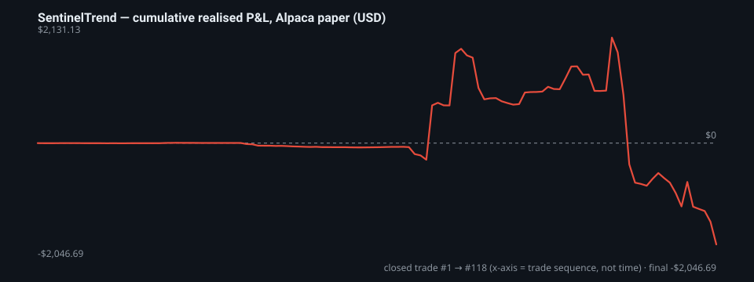

# SentinelTrend — Paper-Trading Track Record (real, unedited)

> **Status: net negative.** Published anyway, in full, because a trading tool that hides its losses is not worth your time.
> Generated 2026-11-06 from the bot's own broker-reconciled journal. Every closed trade is in [`sentinel_paper_trades.csv`](sentinel_paper_trades.csv) — recompute the numbers yourself.

**What this is:** the complete realised P&L of SentinelTrend running on an **Alpaca paper (simulated) account**, mostly in autonomous mode, with real market data and simulated fills. **What this is not:** live money, a backtest, a performance claim, or financial advice. Paper fills are optimistic (no real slippage/queue position), so live results would likely be *worse*, not better.


## Headline numbers

| Metric | Value |
|---|---|
| Period (UTC) | 2026-05-26 → 2026-10-29 |
| Closed trades | 118  (42 wins, 75 losses, 1 flat) |
| Open at snapshot (excluded) | 5 |
| Win rate | 35.6% |
| Net realised P&L | **-$2,046.69** |
| … as % of a nominal $100k paper account | **-2.05%** |
| Gross profit / gross loss | $4,999.73 / -$7,046.41 |
| Profit factor | **0.71**  (< 1.0 = losing) |
| Average win / average loss | $119.04 / -$93.95 |
| Expectancy per trade | -$17.34 |
| Largest win / largest loss | $1,098.55 / -$1,398.93 |
| Max drawdown of cumulative P&L | -$4,177.82 |
| Max consecutive losses | 8 |
| Median holding time | 30 min |





## By strategy

`unlabeled` = trades reconciled from broker fills without a strategy tag (manual or pre-tagging builds).

| Strategy | n | Win rate | Net P&L |
|---|---|---|---|
| unlabeled | 64 | 35.9% | -$1,969.04 |
| halt_resume | 18 | 55.6% | $6.30 |
| afternoon_fade | 12 | 16.7% | -$21.92 |
| catalyst_frontrun | 9 | 11.1% | -$55.64 |
| frontier | 6 | 66.7% | $3.62 |
| extended_news | 4 | 50.0% | $0.05 |
| gap_fade | 3 | 0.0% | -$0.87 |
| opening_range_breakout | 2 | 0.0% | -$9.20 |

## By exit reason

| Exit reason | n | Win rate | Net P&L |
|---|---|---|---|
| signal_exit_loss | 48 | 0.0% | -$1,166.38 |
| time_stop | 42 | 42.9% | -$922.94 |
| signal_exit_win | 25 | 96.0% | $44.35 |
| BrokerSync | 3 | 0.0% | -$1.71 |

## By side

| Side | n | Win rate | Net P&L |
|---|---|---|---|
| Long | 91 | 34.1% | -$771.42 |
| Short | 27 | 40.7% | -$1,275.26 |

## By month (exit date)

| Month | n | Net P&L |
|---|---|---|
| 2026-05 | 3 | -$1.71 |
| 2026-06 | 55 | -$83.53 |
| 2026-08 | 5 | $8.31 |
| 2026-09 | 20 | $854.16 |
| 2026-10 | 35 | -$2,823.92 |

## Earlier log (before the journal reset)

A previous journal covering **2026-05-01 → 2026-05-04** was archived when the journal was reset: **79 closed trades, net -$61.22, win rate 34.2%**. It is reported here for completeness and is *not* included in the headline numbers or the CSV.

## How to read this honestly

- **The bot lost money on paper.** Profit factor below 1 and a win rate around a third mean the current strategy set does not have an edge in this period. That is a data point about the strategies — the software itself (execution, bracket orders, broker sync, risk breakers) did its job and is what is open-sourced here.
- **No cherry-picking.** All strategies, all symbols, all exits (including `time_stop` and `BrokerSync` reconciliations) are included. The 5 positions still open at snapshot time are excluded only because they have no realised P&L yet.
- **Shared account.** The same paper account was also used for manual testing and by Titan HFT; account equity is therefore *not* a clean measure of this bot and is deliberately not shown. Per-trade realised P&L from the bot's own journal is.
- **Margin.** Some positions exceeded $100k notional (paper buying power ≈ 2.9×). The % figure above is relative to a nominal $100k, not to margin-adjusted capital.
- **Prices vs P&L.** `entry_price`/`exit_price` are average fill prices; `realized_pnl_usd` is the broker-reconciled figure. For scaled positions they may not multiply out exactly.
- **Nothing is annualised.** 5 months and 118 trades is a small sample; treat every ratio above as noisy.


## Reproduce

```bash
python3 - <<'PY'
import csv
rows=list(csv.DictReader(open('sentinel_paper_trades.csv')))
pnl=[float(r['realized_pnl_usd']) for r in rows]
print(len(pnl),'trades  net',round(sum(pnl),2),' win rate',round(100*sum(p>0 for p in pnl)/len(pnl),1))
PY
```
The report is regenerated by `scripts/build_track_record.py` in the publishing pipeline on every release; the journal itself is never edited by hand.


---
*MIT · AS-IS · zero warranty · not financial advice. Paper trading ≠ live trading.*
