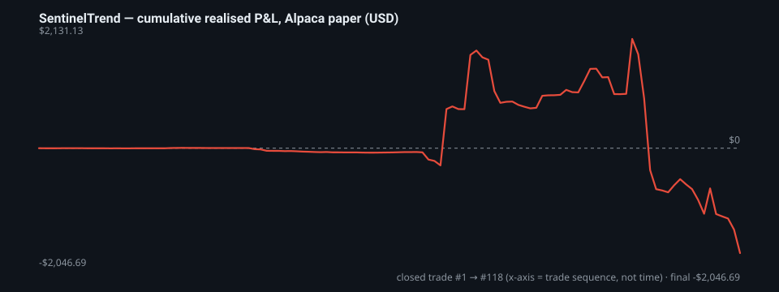

# SentinelTrend — Istoric real de paper-trading (needitat)

> **Stare: net negativ.** Publicat oricum, integral, pentru că un instrument de trading care își ascunde pierderile nu merită timpul tău.
> Generat la 2026-11-06 din jurnalul propriu al botului, reconciliat cu brokerul. Fiecare tranzacție închisă este în [`sentinel_paper_trades.csv`](sentinel_paper_trades.csv) — recalculează singur cifrele.

**Ce este:** P&L-ul realizat complet al SentinelTrend rulând pe un **cont Alpaca paper (simulat)**, în mare parte în mod autonom, cu date de piață reale și execuții simulate. **Ce nu este:** bani reali, backtest, o promisiune de performanță sau sfat financiar. Execuțiile paper sunt optimiste (fără slippage real / poziție în coadă), deci rezultatele live ar fi probabil *mai slabe*, nu mai bune.


## Cifrele principale

| Indicator | Valoare |
|---|---|
| Perioadă (UTC) | 2026-05-26 → 2026-10-29 |
| Tranzacții închise | 118  (42 câștig, 75 pierdere, 1 flat) |
| Deschise la momentul snapshot-ului (excluse) | 5 |
| Rată de câștig | 35.6% |
| P&L net realizat | **-$2,046.69** |
| … ca % dintr-un cont paper nominal de 100k $ | **-2.05%** |
| Profit brut / pierdere brută | $4,999.73 / -$7,046.41 |
| Profit factor | **0.71**  (< 1,0 = pe pierdere) |
| Câștig mediu / pierdere medie | $119.04 / -$93.95 |
| Așteptare per tranzacție | -$17.34 |
| Cel mai mare câștig / cea mai mare pierdere | $1,098.55 / -$1,398.93 |
| Drawdown maxim al P&L cumulat | -$4,177.82 |
| Pierderi consecutive maxime | 8 |
| Durată mediană de deținere | 30 min |





## Pe strategie

`unlabeled` = tranzacții reconciliate din execuțiile brokerului fără etichetă de strategie (manuale sau build-uri dinaintea etichetării).

| Strategie | n | Rată câștig | P&L net |
|---|---|---|---|
| unlabeled | 64 | 35.9% | -$1,969.04 |
| halt_resume | 18 | 55.6% | $6.30 |
| afternoon_fade | 12 | 16.7% | -$21.92 |
| catalyst_frontrun | 9 | 11.1% | -$55.64 |
| frontier | 6 | 66.7% | $3.62 |
| extended_news | 4 | 50.0% | $0.05 |
| gap_fade | 3 | 0.0% | -$0.87 |
| opening_range_breakout | 2 | 0.0% | -$9.20 |

## După motivul ieșirii

| Motiv ieșire | n | Rată câștig | P&L net |
|---|---|---|---|
| signal_exit_loss | 48 | 0.0% | -$1,166.38 |
| time_stop | 42 | 42.9% | -$922.94 |
| signal_exit_win | 25 | 96.0% | $44.35 |
| BrokerSync | 3 | 0.0% | -$1.71 |

## După direcție

| Direcție | n | Rată câștig | P&L net |
|---|---|---|---|
| Long | 91 | 34.1% | -$771.42 |
| Short | 27 | 40.7% | -$1,275.26 |

## Pe lună (data ieșirii)

| Lună | n | P&L net |
|---|---|---|
| 2026-05 | 3 | -$1.71 |
| 2026-06 | 55 | -$83.53 |
| 2026-08 | 5 | $8.31 |
| 2026-09 | 20 | $854.16 |
| 2026-10 | 35 | -$2,823.92 |

## Jurnal anterior (dinaintea resetării)

Un jurnal anterior pentru **2026-05-01 → 2026-05-04** a fost arhivat la resetarea jurnalului: **79 tranzacții închise, net -$61.22, rată de câștig 34.2%**. Este raportat pentru completitudine și *nu* este inclus în cifrele principale sau în CSV.

## Cum se citește corect

- **Botul a pierdut bani pe paper.** Profit factor sub 1 și o rată de câștig de aproximativ o treime înseamnă că setul actual de strategii nu are avantaj statistic în această perioadă. Este o concluzie despre strategii — software-ul în sine (execuție, ordine bracket, sincronizare cu brokerul, întrerupătoare de risc) și-a făcut treaba și el este ceea ce publicăm open-source.
- **Fără selecție.** Toate strategiile, toate simbolurile, toate ieșirile (inclusiv `time_stop` și reconcilierile `BrokerSync`) sunt incluse. Cele 5 poziții încă deschise la snapshot sunt excluse doar pentru că nu au P&L realizat.
- **Cont partajat.** Același cont paper a fost folosit și pentru teste manuale și de Titan HFT; echitatea contului *nu* este o măsură curată a acestui bot și nu este afișată intenționat. P&L-ul realizat per tranzacție, din jurnalul propriu al botului, este.
- **Marjă.** Unele poziții au depășit 100k $ noțional (putere de cumpărare paper ≈ 2,9×). Procentul de mai sus este raportat la 100k $ nominal, nu la capital ajustat cu marja.
- **Prețuri vs P&L.** `entry_price`/`exit_price` sunt prețuri medii de execuție; `realized_pnl_usd` este valoarea reconciliată cu brokerul. La pozițiile scalate, înmulțirea nu dă exact.
- **Nimic nu este anualizat.** 5 luni și 118 tranzacții e un eșantion mic; tratează fiecare raport de mai sus ca zgomotos.


## Reproducere

```bash
python3 - <<'PY'
import csv
rows=list(csv.DictReader(open('sentinel_paper_trades.csv')))
pnl=[float(r['realized_pnl_usd']) for r in rows]
print(len(pnl),'tranzactii  net',round(sum(pnl),2),' rata castig',round(100*sum(p>0 for p in pnl)/len(pnl),1))
PY
```
Raportul este regenerat de `scripts/build_track_record.py` în pipeline-ul de publicare la fiecare versiune; jurnalul în sine nu este editat manual niciodată.


---
*MIT · AS-IS · fără garanții · nu este sfat financiar. Paper trading ≠ tranzacționare reală.*
